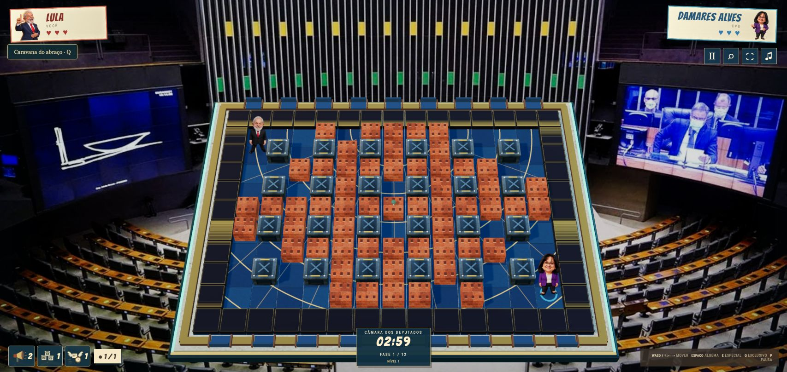

# Batalha das Urnas

**Um jogo. Dois lados. As mesmas regras.**

Entre na arena de uma sátira política brasileira: escolha a campanha de Lula ou de Flávio, enfrente adversários em cenários inspirados em Brasília e avance com habilidades, itens e falas marcantes. São **28 personagens**, duas campanhas e cinco níveis de dificuldade.

O jogo é gratuito, sem assinatura ou compras internas. Não tem vínculo com partidos, candidatos ou campanhas e não recomenda voto.

> **Os downloads ainda não foram liberados.** Este repositório apresenta o jogo e suas informações. A Versão 1.0 será disponibilizada na seção [Releases](https://github.com/ParmalatBR/Batalha-das-Urnas/releases) quando estiver liberada.

## Escolha sua arena

*Capturas reais do jogo, realizadas em 17/10/2026. Fotografia do plenário na arena: Câmara dos Deputados – TV Câmara, [PlenárioCamaradeputados.jpg](https://commons.wikimedia.org/wiki/File:Plen%C3%A1rioCamaradeputados.jpg), [CC BY-SA 4.0](https://creativecommons.org/licenses/by-sa/4.0/). No jogo, a fotografia foi redimensionada, convertida e enquadrada com vinheta e sobreposição da arena/interface; sua atribuição e condição de compartilhamento pela mesma licença são preservadas. Demais recursos: [créditos](CREDITOS.txt).*

- **Campanha:** dois percursos, evolução de personagens, adversários, minibosses, chefes finais e superbosses internacionais desbloqueáveis.
- **Batalha rápida:** entre direto em uma partida.
- **Sobrevivência, Caos Institucional e Desafio dos chefes:** diferentes desafios para variar o combate.
- **PvP Local:** dispute com outra pessoa no mesmo computador.

As campanhas e os modos locais funcionam offline no Windows, sem exigir conta. O **PvP Online está temporariamente indisponível**.

As cinco dificuldades permitem ajustar o desafio. No **Extremo**, perder para qualquer adversário reinicia a campanha na fase 1 e zera sua evolução. O jogo pede confirmação antes de ativar esse modo ou recomeçar uma campanha; empates não acionam essa penalidade.

## Plataformas e downloads previstos

| Plataforma | Opção | Situação |
| --- | --- | --- |
| Windows 10 ou posterior, 64 bits | Instalador — opção principal | Aguardando liberação |
| Windows 10 ou posterior, 64 bits | ZIP portátil — alternativa sem instalação | Aguardando liberação |
| Android 7.0 ou posterior | APK para instalação direta | Aguardando liberação e testes em aparelho real |

Os nomes dos arquivos previstos são `Batalha-das-Urnas-Setup.exe`, `Batalha-das-Urnas-Windows-Portatil.zip` e `Batalha-das-Urnas-Android.apk`. Os respectivos hashes estão em [SHA256SUMS.txt](SHA256SUMS.txt); a presença dos hashes não significa que os downloads já estejam disponíveis.

## Como jogar no Windows

Quando os arquivos forem liberados, use preferencialmente o **instalador**: feche o jogo, execute o Setup e escolha a pasta e os atalhos desejados.

Se preferir a **versão portátil**, extraia o ZIP inteiro e abra `BatalhaDasUrnas.exe`. Mantenha os demais arquivos junto ao executável e não execute diretamente de dentro do ZIP.

Pressione **F11** para alternar entre janela e tela cheia. Consulte os controles dentro do jogo. Ao terminar, use **Sair do jogo** e aguarde o salvamento. Se aparecer uma falha ao salvar, siga a orientação exibida antes de fechar.

Seu progresso fica separado da instalação. Atualizar ou desinstalar o jogo preserva esses dados. Antes de trocar de computador, use a exportação em **Controles e Progresso**; copiar apenas a pasta portátil não transfere sua campanha.

## Sobre o APK Android

A versão Android foi preparada para jogar na horizontal, com controles por toque. A instalação direta pode exigir autorização do Android para a origem do download. Respeite os avisos de segurança do aparelho; não desative suas proteções para instalar o jogo.

Após a liberação dos downloads:

1. Baixe `Batalha-das-Urnas-Android.apk` neste repositório usando o celular.
2. Abra o arquivo baixado e siga as instruções do Android para autorizar essa origem, se solicitado.
3. Conclua a instalação, abra **Batalha das Urnas** e vire o aparelho para a horizontal.

O APK **ainda não foi testado em um aparelho real**. Instalação, desempenho, som, controles simultâneos e retomada após suspensão continuam sem confirmação em celular. Não há lançamento na Google Play nem versão para iPhone anunciados nesta entrega.

## Créditos e contato

Fotografias, gravações, músicas, fontes e bibliotecas estão identificadas em [CREDITOS.txt](CREDITOS.txt) e em **Créditos e fontes** dentro do jogo. Os materiais de terceiros mantêm seus respectivos direitos; a gratuidade do jogo não altera suas licenças.

Veja também as [notas da Versão 1.0](RELEASE-NOTES.md).

Dúvidas, sugestões ou problemas: **[contato.batalhadasurnas@gmail.com](mailto:contato.batalhadasurnas@gmail.com)**. Ao relatar um problema, informe a versão do jogo, seu sistema e o que aconteceu. Não envie senhas ou códigos de recuperação.

**Batalha das Urnas — Desenvolvimento Independente.** © 2026. Este repositório contém a apresentação e a documentação de distribuição; o código-fonte de desenvolvimento não é publicado aqui.
